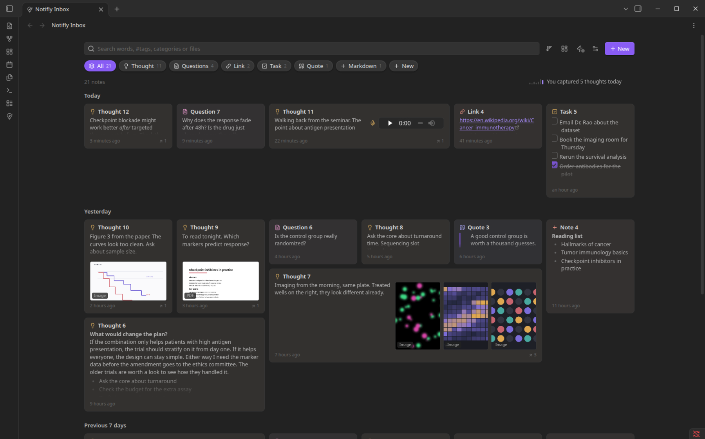
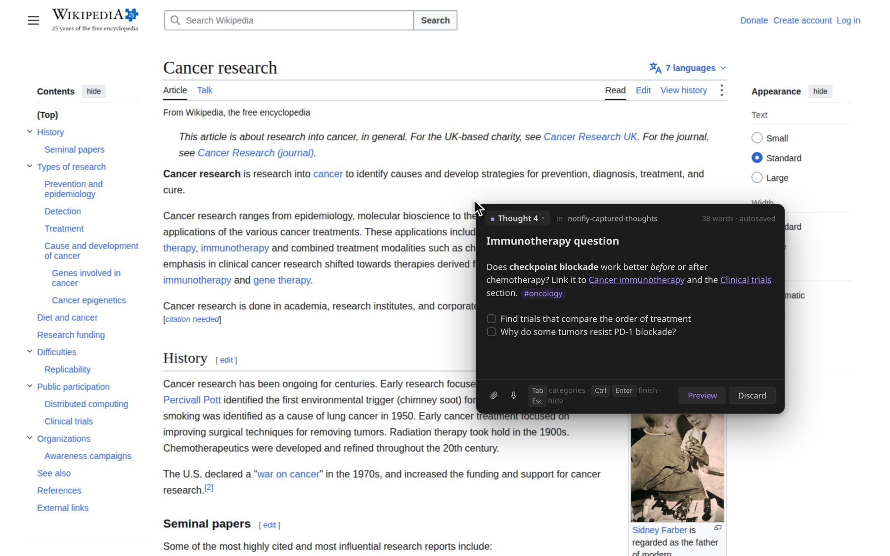
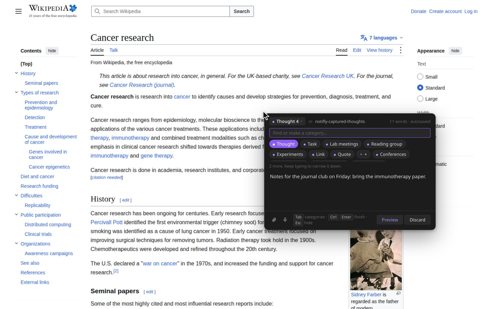
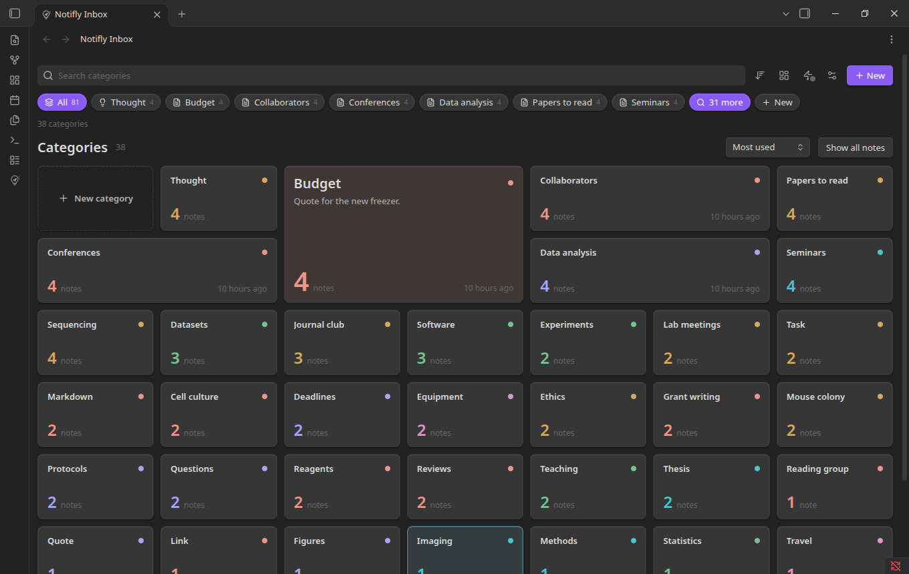
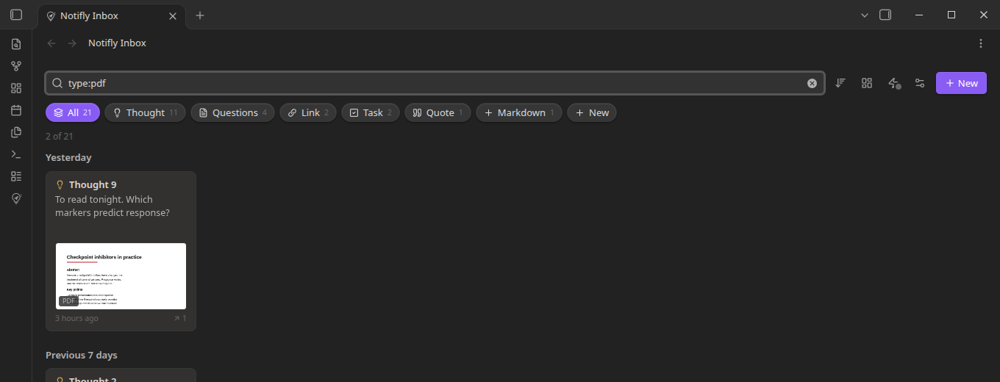
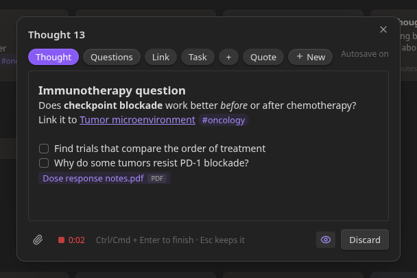
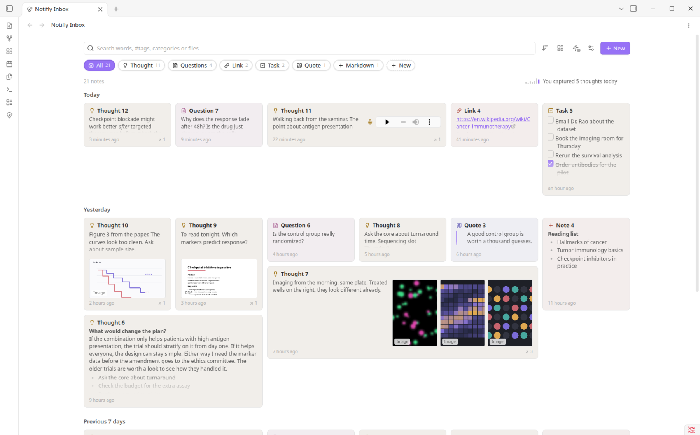
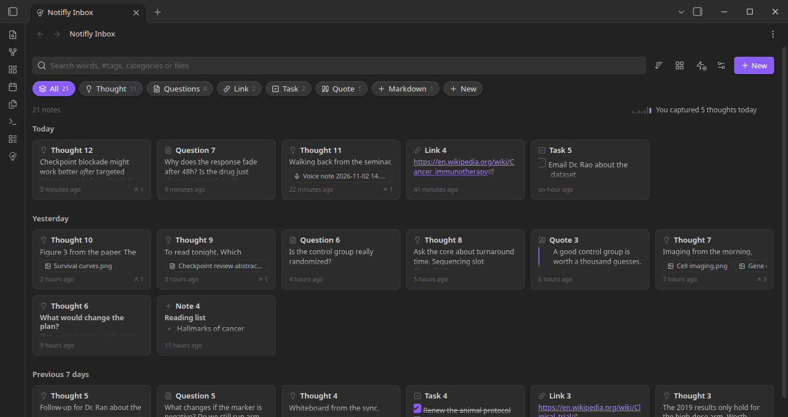

<p align="center">
  
</p>

<h1 align="center">Notifly</h1>

<p align="center">
  A free community plugin for Obsidian. Capture thoughts, files and voice notes from anywhere, even when Obsidian is closed.
</p>

<p align="center">
  <a href="https://github.com/Phantom-Con-Artist/Notifly/releases/latest"></a>
  <a href="LICENSE"></a>
  
  
  <a href="https://github.com/Phantom-Con-Artist/Notifly/actions/workflows/lint.yml"></a>
  
</p>

<p align="center">
  
</p>

Notifly is an independent, open-source plugin made by one person for people who use [Obsidian](https://obsidian.md). It is **not** an official Obsidian product, and Obsidian does not make or support it. It adds a quick-capture window and an inbox to your own vault.

Press **Alt+C** anywhere. A small window opens at your pointer. Type, press **Ctrl+Enter**, and the thought is a normal note in your vault. Everything you capture lands in the **Notifly inbox**, where you can see what is in each note without opening it.

## What it does

**Capture**
- Alt+C opens a small window instantly, even when Obsidian is closed. You can change the key.
- Markdown looks right as you type: headings, checkboxes, links. Typing `[[` suggests your notes.
- It saves as you type, so nothing is lost. Esc hides the window and keeps your words.
- Add anything: PDFs, pictures, sound, video and other files. Paste, drop, or use the paperclip.
- Record a voice note with the mic button.

**Categories**
- Three come ready: Thought, Task and + (plain Markdown). Link and Quote are one click away.
- Make your own by typing a name. They appear as pills in the capture window and the inbox.
- It stays tidy with thousands of categories: a few pills, a find box for the rest.

**Inbox**
- A bento grid. Notes are sized by what they hold, and each tile shows the real thing: text, pictures, the first page of a PDF, video frames, and a player for voice notes.
- A category overview, also a bento grid, sorted by use. One switch turns all of it back to a plain, even grid.
- Search words, `#tags`, `cat:Lab`, `file:report` and `type:pdf`. It suggests as you type.
- Sort by newest, oldest, edited, name, most linked, category, recently opened or most opened.
- Remove a thought from its tile. It goes to Obsidian's trash.
- Follows your theme, light or dark.

**Your notes stay yours**
- Plain `.md` files in one folder. Links, backlinks and the graph just work.
- Rename or move the folder in Obsidian. Notifly keeps up.

## Screenshots

<p align="center">
  <br>
  <sub>Alt+C while reading. Background: Wikipedia, "Cancer research" (CC BY-SA 4.0).</sub>
</p>

| | |
|---|---|
|  |  |
| Find or make a category by typing. | All categories, biggest first. |
|  |  |
| Search by file type, tag, category or name. | The same capture window inside Obsidian. |
|  |  |
| Light theme. | Normal layout, one click. |

## Install

**1. The plugin.** When Notifly is in Obsidian's Community plugins, install it there. Until then, download `main.js`, `manifest.json` and `styles.css` from the [latest release](https://github.com/Phantom-Con-Artist/Notifly/releases/latest), put them in `<your vault>/.obsidian/plugins/notifly/`, and turn Notifly on in **Settings → Community plugins**.

**2. Quick capture** (the small app that makes Alt+C work). Notifly never downloads it for you.

1. In the inbox, choose **Get quick capture**. Your browser opens the release page.
2. Download the file for your system:
   - Windows: `notifly-daemon-windows-x86_64.exe`
   - Mac with an Apple chip: `notifly-daemon-macos-arm64`
   - Linux: `notifly-daemon-linux-x86_64`
3. Choose **Show the folder** and save the file there. You do not need to rename it.
4. Choose **Turn on quick capture**. Turn it off the same way. It does not start by itself when you sign in.

Each download has a `.sha256` file so you can check it. Linux needs WebKitGTK 4.1 and GTK 3. Voice notes on Linux use PipeWire, PulseAudio or ALSA. Intel Macs are not built yet.

## Keys

| Key | What it does |
|---|---|
| Alt+C | Open the capture window (change it in the options) |
| Tab or Alt | Pick a category. Type to find one, Ctrl+Enter to make a new one |
| Ctrl+Enter | Finish |
| Esc | Hide the window and keep your words |
| Alt+P | Show or hide formatting |
| Ctrl+click a link | Open it in your browser |

## Privacy and permissions

- **Network use: none.** Notifly makes no network requests and sends no data. Opening the release page happens in your browser.
- **Files outside your vault.** Quick capture is a separate program, so it works when Obsidian is closed. It only reads and writes inside your vault: the capture folder and its own folder in `.obsidian/plugins/notifly/helper/`.
- **It runs a program.** Turning on quick capture starts the app you saved, with your account's permissions. Only use files from this project's release page. On Linux and macOS, Notifly marks that file as runnable before starting it.
- **Microphone.** Used only while you record a voice note.
- **No telemetry, no ads, no account, no payment.**
- On KDE Plasma, quick capture loads a tiny window-placement script while it runs and removes it when it stops.

## Status

Built and tested on Linux (KDE Plasma, Wayland). The Windows and macOS builds are in the release but have had less testing. Please open an issue if something is off.

## For developers

```sh
npm install
npm run build        # capture window page, plugin and styles.css
npm run lint
cd daemon && cargo build --release && cargo test
```

`styles.css` is generated from `styles.base.css` and `daemon/ui/live.css`. Edit those, not `styles.css`. To release, run `npm version patch` (the tag has no `v`: `1.0.1`) and push the commit and tag. One workflow builds the plugin and the quick capture app for all three systems into one draft release.

## License

MIT, Copyright (c) 2026 Subhradeep Sarkar. See [LICENSE](LICENSE). It covers the plugin and the quick capture app. Third-party code is listed in [THIRD_PARTY_NOTICES.md](THIRD_PARTY_NOTICES.md).

Notifly is not made, endorsed or supported by Obsidian. "Obsidian" is a trademark of its owner, used here only to say what Notifly works with. Questions and problems go to this repository's [issues](https://github.com/Phantom-Con-Artist/Notifly/issues), not to Obsidian's support.
